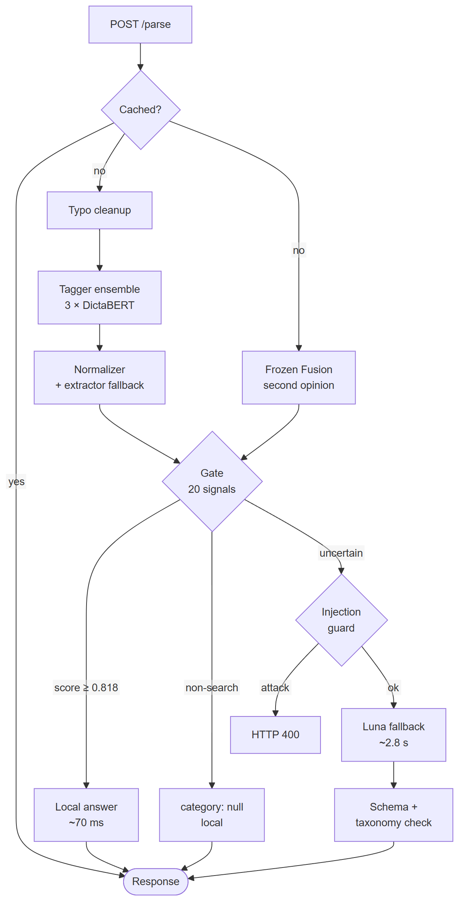
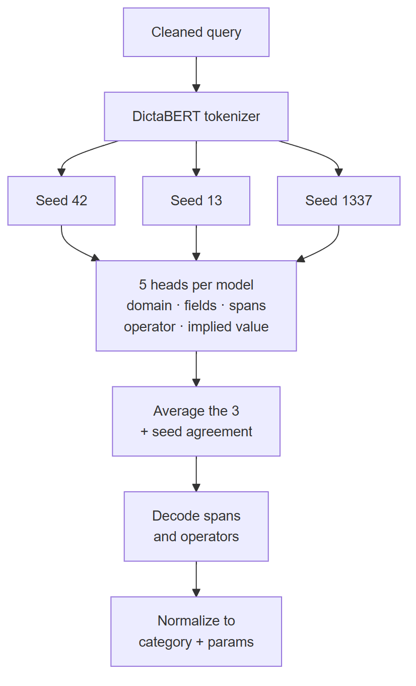
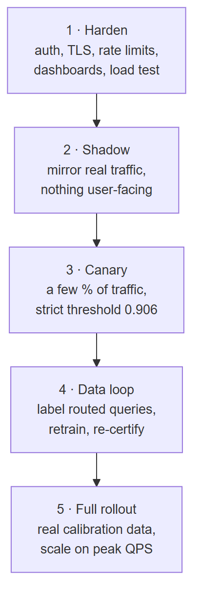

# Yad2 search understanding API

A Dockerized FastAPI service that turns Hebrew marketplace searches (slang, typos, numeric bounds and all) into
structured filters for **נדל״ן**, **רכב** and **יד_שנייה**.

A fine-tuned Hebrew tagger answers most queries locally in about 70 ms. A confidence gate, which uses a second,
independent local parser as a cross-check, sends only the uncertain ones to an OpenAI fallback.

**Setup and reproduction: [SETUP.md](SETUP.md).** History of the work: the [training journey](training/journey.html).

## Results at a glance

All on the 2,181-query test set over Docker HTTP, unless stated otherwise.

| system | JSON exact | answered locally | latency p50 / p95 | LLM cost per 10M queries |
| --- | --- | --- | --- | --- |
| Frozen Fusion: frozen E5 + rules, local only (offline harness) | 75.4% | – | – | – |
| Fine-tuned tagger, local only (offline harness) | 85.1% | – | – | – |
| **Tagger + gate + Luna fallback** (Luna low, 0-shot; hybrid rule on) | **87.94%** | **77.8%** | **77 ms / 3.58 s** | **$258** |
| ↳ same run, re-scored with the hybrid rule off (the recommended profile) | ≈ 90.0% | 77.8% | same | $258 |
| Luna only, low, **0-shot** (the fallback's own configuration) | 82.26% | 0% | 2.31 s / 3.91 s | $1,116 |
| Luna only, low, 12-shot ‡ | 89.36% | 0% | 2.06 s / 3.29 s | $1,133 |
| Luna only, medium, 12-shot ‡ | 90.23% | 0% | 2.18 s / 4.00 s | $1,311 |

‡ The few-shot examples were chosen after reviewing test errors (`exposed_regression` in their reports), so these
scores are regression evidence, not independent estimates.

**The comparison is against Luna,** the most cost-effective LLM we evaluated and the one the fallback uses.
- **Against the same Luna configuration it routes to** (low reasoning, 0-shot), the system adds **about 6–8 points**
  (82.3% → 87.9–90%) while sending only 22% of queries to Luna.
- **It matches Luna even with 12 test-informed examples** (89.4%) or medium reasoning (90.2%). It does that at about a
  fifth of the LLM cost (**$258 against $1,116–1,311 per 10M queries**), and answers 78% of queries about 40× faster.
- **A larger model** (Terra, 93.6%) is listed under [Evaluation reports](#evaluation-reports) for reference. It costs
  about 23× more per query in LLM tokens, so it isn't the baseline for a cost-efficient service.

**Caveats:**
- **The runs differ in prompt, few-shot count, security policy and concurrency**, so this isn't a controlled
  comparison. The details are under [Evaluation reports](#evaluation-reports).
- **The test set has been inspected during development.** Treat it as regression evidence, not an untouched estimate.

## 1. What was designed

### Request path

<p align="center"></p>

<sub>Source: <a href="docs/diagrams/request_path.mmd">docs/diagrams/request_path.mmd</a> (Mermaid), rendered to PNG so the text is never clipped.</sub>

Every request is validated first (a strict schema, at most 2,000 characters). The details of each box follow.

### The components
- **Tagger** (`src/tagger`): **three** DictaBERT-base models, fine-tuned end to end with different random seeds,
  whose predictions are averaged. The ensemble beats any single model, and seed agreement doubles as a confidence
  signal. Each model predicts:
  - the domain
  - which of the 69 fields are present
  - BIO spans in the text
  - each span's operator (exact / min / max / range / true / false)
  - values implied without a span (the sector from the item word)
- **Normalizer** (`src/tagger/normalize.py`): deterministic. It turns span text into canonical values (Hebrew number
  words with typo repair, units, bounds, lexicon matching, taxonomy rules). When a span yields no value, a field-local
  extractor is the fallback.
- **Frozen Fusion** (`src/frozen_fusion`): the earlier local parser, frozen multilingual-E5 + TF-IDF + logistic heads.
  It runs on every query as an **independent second opinion**. When it produces the same JSON as the tagger, the
  tagger's answer is right about 96% of the time.
- **Gate** (`src/tagger/gate.py`): a logistic model over 20 signals. They include the tagger's own confidences, how
  many of the three seeds agree, presence margins, whether the fallback was used, and agreement with Frozen Fusion.
  The output is the estimated probability that the whole parse is exactly right. The shipped threshold, **0.818**, was
  chosen for a 95% target on validation data.
- **LLM fallback** (`src/llm`): OpenAI Responses API with a fixed extraction and security prompt, the query
  JSON-encoded in its own message, a taxonomy catalog, and strict output validation.

### Model internals

<p align="center"></p>

<sub>Source: <a href="docs/diagrams/model_internals.mmd">docs/diagrams/model_internals.mmd</a> (Mermaid), rendered to PNG so the text is never clipped.</sub>

**Safeguards on serving:**
- Serving loads only versioned artifacts (`src/artifacts/`, `src/extraction/artifacts/`) and provisioned weights. It
  never reads training data and never imports training code; a test enforces this.
- **Both gates are bound to what they were calibrated on:** the models, the artifacts, a fingerprint of the encoder,
  and the inference source code. A mismatch refuses to start.

Code layout: [runtime architecture](docs/runtime-architecture.md). The tagger in depth:
[docs/tagger-parser.md](docs/tagger-parser.md).

## 2. Setup

See **[SETUP.md](SETUP.md)**: environment, getting the models (the artifact zip, or provisioning), serving profiles,
Docker and native runs, tests, evaluations and benchmarks.

Quick start for the full pipeline:
1. Unzip the artifact package at the repo root.
2. Set `PARSER_MODE=combined`, `LOCAL_PARSER=tagger`, `EXTRACTOR_ENABLED=true` and your OpenAI key and model in `.env`.
3. Run `.\scripts\docker-build-and-run.ps1` (or `bash scripts/docker-build-and-run.sh`).

## 3. Scale and performance

### Achieved (measured)

| what | result | evidence |
| --- | --- | --- |
| **Local path throughput, one container** | **12 QPS sustained** with p50 79 ms, p95 **179 ms**, p99 233 ms, 0 errors; unique validation queries, cache off | [docs/benchmark_local.json](docs/benchmark_local.json) (`scripts/benchmark_local.py`) |
| Local answers inside the full pipeline | p50 71 ms, **p95 109 ms** | combined HTTP report |
| Overall HTTP latency, full pipeline | p50 **77 ms** (most queries never reach the LLM) | combined HTTP report |
| Memory | about 3 GB RAM per container (3 encoders in fp32 + Frozen Fusion's E5) | `docker stats` |
| Startup | about 9 s (checksum checks, gate verification, warm-up) | logs |

### Not achieved, or not demonstrated
- **p95 for the whole pipeline is 3.58 s,** above the 600 ms model-path target. The 22% of queries that go to the LLM
  take 2.8 s at the median (5.0 s at p95), all provider latency. Only routing fewer queries, or a faster fallback,
  changes that.
- **The per-container ceiling is about 12.6 QPS.** Inference runs one query at a time per process
  (`CapacityLimiter(1)`, about 80 ms each), so offered at 16 QPS the queue grows without bound (p50 7.9 s). Scaling
  today means more containers. Neither more workers per container nor batching has been built.
- **The benchmarks ran on a development laptop** (Docker Desktop, 24 logical CPUs), not on production hardware.
- **No long soak test, and no multi-container or load-balancer test.**
- **The cache is per process,** with no request coalescing, so concurrent identical misses both run inference.

## 4. Cost efficiency

### Measured per-query costs
From the recorded runs' token usage and the 2026-11-17 price table:
- **An LLM call** in the combined run costs **$0.000117** (482 calls, $0.056 in total). Most input tokens are served
  from the provider's prompt cache.
- **LLM-only** costs **$0.000113 per query** (recorded run, a different prompt).
- **A local answer** has no LLM cost.

### Estimate for 10M queries a month

| | LLM-only | tagger + gate + fallback (today) | + confident non-searches local |
| --- | --- | --- | --- |
| share of queries sent to the LLM | 100% | 22.1% | about 17.8% |
| **LLM tokens** | **$1,133** | **$258** | **about $208** |
| hosting* | about $30–60 (a small API host) | about $220–290 (2 × 4 vCPU / 8 GB) | about $220–290 |
| **total a month** | **about $1,170–1,190** | **about $480–550** | **about $430–500** |

\* Hosting is an assumption (on-demand cloud VMs at about $0.15–0.20 an hour each), not a measured bill. 10M a month
averages 3.9 QPS. Assuming peaks about 3× the average (about 12 QPS), that's one container at its measured ceiling,
so two for headroom and availability.

**What the design saves at 10M a month:**
- **The LLM bill falls by about 77%** today, and by up to about **82%** once confident non-searches are answered
  locally. That change has been shipped since the run but not re-measured live: the run sent 93 non-search queries
  to the LLM, and the tagger had all of them right.
- **The total, including hosting, falls by about 55–60%.**

**What scales how:** the LLM savings grow linearly with traffic; hosting grows in steps of one container per about
12 QPS of peak. At 33M a month the LLM line alone goes from about $3,750 to about $690–850.

**Caveats:**
- **The fallback queries are the hard ones.** The 22% sent to the LLM are the queries the tagger is least sure about,
  so their token use could differ from the LLM-only average.
- **Excluded:** taxes, egress and engineering time.
- **The totals are offline estimates from the reports.** Dollars aren't exported as a live metric; tokens are.

## 5. Observability

`GET /metrics` is a Prometheus endpoint on the API port, and it's reachable from
Docker. The evaluation runs read their routing and token counters from it. Labelled series appear after their first
event: `parse_routing_total`, for example, shows up after the first parse.

| metric | type | what it tells you |
| --- | --- | --- |
| `http_requests_total{route,method,status}`, `http_request_duration_seconds` | counter, histogram | traffic, errors, latency per route |
| `parse_requests_total{category}` | counter | successful parses per domain (`none` = not a search) |
| `parse_routing_total{destination,reason}` | counter | **the routing decision**: `local/accepted`, `local/non_search`, `fallback/low_confidence`, `fallback/unsupported_category`, `fallback/empty_extraction`, … |
| `parse_confidence` | histogram | the gate's score distribution, so drift is visible |
| `parse_cache_hits_total`, `_misses_total`, `_evictions_total`, `parse_cache_entries` | counter, gauge | cache effectiveness |
| `openai_calls_total{outcome}`, `openai_duration_seconds` | counter, histogram | fallback volume, failures, provider latency |
| `openai_tokens_total{kind}` | counter | input / output / cached / reasoning tokens. Cached and reasoning are subsets, not extra. |
| `llm_security_rejections_total{reason}` | counter | prompt-injection rejections |

**Logs:**
- **Structured JSON per request and per routing decision:** route, status, latency, cache outcome, category,
  destination, reason, confidence, threshold.
- **Never logged:** query text, provider exception messages, credentials. Keep Uvicorn access logs off, as configured.

**Not built yet:**
- a build-info metric (model, gate and threshold version)
- per-stage latency (tagger / Frozen Fusion / LLM)
- tagger signals: cleaner rewrite rate, Frozen Fusion agreement rate
- a live cost gauge
- dashboards, alerts, distributed tracing

## 6. Security

### What's in place
- **Input contract:** a strict request schema (only `q`, a nonblank string of at most 2,000 characters, trimmed), with
  422 on anything else.
- **Prompt-injection defence on the LLM path:**
  - a heuristic guard run on normalized text (Unicode, invisible characters, HTML, percent-encoding, escapes). It
    returns 400 and makes no provider call, and rejections aren't cached.
  - a mandatory fixed security policy in the prompt
  - the query sent JSON-encoded in its own message
  - a taxonomy allowlist
- **Output validation:** every answer, local or LLM, is checked against the versioned schema and taxonomy (field
  names, value types, enum values, bounds) before it's returned.
- **Tested:** unit tests in English and Hebrew, plus a Docker red-team evaluation that passed 19/19 cases
  ([report](eval/results/security_20261117T125937Z_c1121a25/REPORT.md), [details](docs/prompt-injection-protection.md)).
- **Secrets:**
  - the OpenAI key is a `SecretStr`, read from the environment or `.env` and never printed
  - Docker evaluations pass it by variable name, not on the command line
  - `.env` is git-ignored
- **Container:** a non-root user, models mounted read-only, no model downloads at runtime, no secrets in the image.
- **Integrity:**
  - tagger checkpoints are checked by SHA-256 before loading, and loaded with `torch.load(weights_only=True)`, so no
    pickled code runs
  - both gates refuse to load if a model, artifact, encoder or inference source file changed
  - the artifact zip carries a checksum manifest
- **Privacy:** logs exclude query text, and errors are sanitized (500 responses carry no internals).

### What's missing for a public deployment
- **No authentication and no rate limiting** in the service. Put it behind an authenticated, TLS-terminating gateway
  with per-client rate and concurrency limits.
- **The injection guard is heuristic.** Novel attacks can get past it, and benign queries that quote attack text can be
  rejected. The local path has no LLM to inject into, but adversarial inputs can still produce wrong filters, which
  output validation limits but can't rule out.
- **No dependency or image vulnerability scanning,** and no signed model artifacts (checksums only).
- **No PII policy for logs or the cache yet.** Queries can contain phone numbers or names. The in-memory cache stores
  responses keyed by the query text.

## 7. With more time, and a path to production

### What we'd do next
1. **More data, aimed at what's still failing.** The remaining errors are mostly missing or partial spans: rare place
   names, brands, car-model naming, values stated without their keyword. A targeted training batch is specified in
   [docs/data_requests/y2_train_v3.md](docs/data_requests/y2_train_v3.md). Expected: +1–2 points, and more queries
   answered locally.
2. **Certify the gate at 95%** on a larger, human-written calibration set
   ([docs/data_generation_plan.md](docs/data_generation_plan.md)). Today the routing batch can prove 95% only at 39%
   coverage, because it's too small.
3. **Real traffic, labelled.** The queries the gate sends to the LLM are exactly the ones the tagger can't do yet, and
   they come back labelled. Retraining on them periodically lowers the LLM share over time. This needs a privacy review
   first.
4. **Throughput:**
   - distil the 3-model ensemble into one model, or quantize it to int8 with ONNX Runtime: about 3× faster
   - allow more than one concurrent inference per container
   - micro-batching
5. **Observability:** build-info and per-stage latency metrics, Frozen Fusion agreement and cleaner rewrite rates, a
   live cost gauge, dashboards and alerts on routing share, gate-score drift and provider errors.

### Path to production

<p align="center"></p>

<sub>Source: <a href="docs/diagrams/path_to_production.mmd">docs/diagrams/path_to_production.mmd</a> (Mermaid), rendered to PNG so the text is never clipped.</sub>

**Constraints across all the phases:**
- **Every change to the model, normalizer, cleaner or threshold** goes through the same evaluation gate:
  - validation first
  - a frozen test check
  - a live HTTP evaluation that reports per-request routing
- **Version the weights** in a model registry (Hugging Face Hub or GitHub Releases) instead of a zip, keeping the
  checksum verification.
- **Bound the provider side:** budget alerts, timeouts, and a fallback when the provider is down. Today that's a 503.

## HTTP contract

| endpoint | purpose |
| --- | --- |
| `POST /parse` | parse `{"q": "דירת 3 חדרים בירושלים עד מליון שח"}` |
| `GET /health` | liveness: `{"status": "ok"}` |
| `GET /metrics` | Prometheus metrics for this process |

**Successful responses** contain `category`, `params`, `confidence` (0–1) and `notes`.
- **`category`** is `נדל״ן`, `רכב`, `יד_שנייה` or `null`. A non-search returns `null` with `params: {}`.
- **Numeric filters** are scalars, or `{min}` / `{max}` / `{min,max}` objects.
- **Vehicle keys:** output uses the public `יצרן` / `דגם`.
- **`confidence`:** for a local answer it's the gate's estimate. For an LLM answer it's the model's own rating, marked
  uncalibrated in `notes`.

| status | meaning |
| --- | --- |
| 400 | the LLM input guard recognized a prompt-injection attempt (`prompt_injection_detected`) |
| 422 | invalid request body |
| 503 | escalation with no fallback configured, or provider timeout / unavailability / configuration error |
| 502 | provider refusal, incomplete response or invalid output |
| 500 | unexpected internal failure (sanitized) |

## Evaluation reports

These are recorded **Docker HTTP evaluations of all 2,181 test queries**, with the response cache off.
- **Each run has a `REPORT.md`** (readable on GitHub), plus an interactive `REPORT.html` (open it locally in a
  browser).
- **Next to them:** `summary.json` and `records.jsonl` hold configuration, hashes and per-query evidence, including
  which route answered each query.

| configuration | JSON exact | HTTP p50 / p95 | LLM calls | LLM cost / 10M | report |
| --- | --- | --- | --- | --- | --- |
| **Tagger + Frozen Fusion opinion + Luna fallback** (Luna low, 0-shot) | **87.94%** | **77 ms / 3.58 s** | 482 / 2,181 (22.1%) | **$258** | [md](eval/results/api_test_20261117T134548Z_0af454ba/REPORT.md) · [html](eval/results/api_test_20261117T134548Z_0af454ba/REPORT.html) |
| Luna only, low, 0-shot | 82.26% | 2.31 s / 3.91 s | 2,181 | $1,116 | [md](eval/results/api_test_20261117T085502Z_d07dc252/REPORT.md) · [html](eval/results/api_test_20261117T085502Z_d07dc252/REPORT.html) |
| Luna only, low, 12-shot ‡ | 89.36% | 2.06 s / 3.29 s | 2,181 | $1,133 | [md](eval/results/api_test_20261117T102939Z_e7c60732/REPORT.md) · [html](eval/results/api_test_20261117T102939Z_e7c60732/REPORT.html) |
| Luna only, medium, 12-shot ‡ | 90.23% | 2.18 s / 4.00 s | 2,181 | $1,311 | [md](eval/results/api_test_20261117T110823Z_8d14b6a0/REPORT.md) · [html](eval/results/api_test_20261117T110823Z_8d14b6a0/REPORT.html) |
| Terra only, low, 12-shot ‡ | 93.63% | 2.12 s / 3.56 s | 2,181 | $5,867 | [md](eval/results/api_test_20261117T115643Z_976708ba/REPORT.md) · [html](eval/results/api_test_20261117T115643Z_976708ba/REPORT.html) |

‡ Few-shot examples chosen after reviewing test errors (`exposed_regression`): regression evidence, not independent
estimates.

- **Combined run:**
  - settings: zero few-shot examples, guidelines and the security guard on, `TAGGER_HYBRID_VEHICLE_TYPE=true`, one
    HTTP client
  - routing: 1,697 answered locally (90.39% exact), 482 sent to the LLM (79.67% exact: the harder queries), 2 security
    rejections
  - hybrid rule: with the rule off, the same records score ≈ 90.0%
- **LLM-only runs:** eight concurrent clients, and the earlier prompt from before the mandatory security guard and
  policy. The 0-shot Luna run is the closest like-for-like baseline for the combined run's fallback.
- **All runs:** the same test-data hash, with failures counted as wrong. Cost projections assume the same traffic mix,
  tokens, caching and prices, and exclude hosting.

**Also:**
- the Docker security evaluation, 19/19: [md](eval/results/security_20261117T125937Z_c1121a25/REPORT.md) · [html](eval/results/security_20261117T125937Z_c1121a25/REPORT.html)
- the [few-shot selection and error analysis](docs/few-shot-evaluation.md)
- the [training journey](training/journey.html), with the experiment journals:
  - `training/training_bert/experiment1–4`: tagger, ensemble, second opinion and cleanup, calibration and label
    audit, decoding fixes
  - `training/training_frozen_fusion/`: the Frozen Fusion experiments

## Repository guide

| location | contents |
| --- | --- |
| `src/api`, `src/contracts`, `src/config` | HTTP app, contracts, environment settings |
| `src/tagger`, `src/frozen_fusion`, `src/extraction`, `src/llm` | local inference, extraction, routing, the LLM and security layers |
| `src/infrastructure`, `src/artifacts` | cache, metrics, usage accounting, versioned serving artifacts |
| `scripts`, `tests` | provisioning, packaging, Docker helpers, evaluation and benchmark tools, regression tests |
| `eval/dataset`, `eval/results` | dataset tooling and saved evaluation evidence |
| `training/` | both training histories and [journey.html](training/journey.html) |
| `docs/` | [architecture](docs/runtime-architecture.md), [tagger](docs/tagger-parser.md), [fallback](docs/openai-fallback.md), [security](docs/prompt-injection-protection.md), [data requests](docs/data_requests/y2_train_v3.md), [data plan](docs/data_generation_plan.md) |

## Examples

Real responses from the recorded combined evaluation ([report](eval/results/api_test_20261117T134548Z_0af454ba/REPORT.md)). Each output equals its expected JSON. `POST /parse` also returns `confidence` and `notes`; they're left out here.

**1. Slang, a city name made canonical, a lower bound, a proximity filter** · answered locally, 72 ms

```text
בתל אביב קומה 5 ומעלה קרוב לבתי ספר, משהו פצצה
```
```json
{
  "category": "נדל״ן",
  "params": {
    "עיר": "תל אביב-יפו",
    "קומה": {"min": 5},
    "קרבה": "קרוב לבתי ספר"
  }
}
```

**2. A self-correction («12 סליחה 1»): the corrected value wins** · answered locally, 77 ms

```text
עובר לאזור בגלל עבודה, מחפש נכס בשכונת רמות שיהיה משופץ ועם חניה 12 סליחה 1
```
```json
{
  "category": "נדל״ן",
  "params": {
    "שכונה": "רמות",
    "מצב_נכס": "משופץ",
    "חניה": 1
  }
}
```

**3. A glued city name («בבארשבע»), a number in words, «ומעלה» as a minimum** · answered locally, 90 ms

```text
תראו לי בבארשבע רק חברה משכנת, שמונים מטר בנוי ומעלה כי אני צריך מקום גדול
```
```json
{
  "category": "נדל״ן",
  "params": {
    "עיר": "באר שבע",
    "בעלות_מקרקעין": "חברה משכנת",
    "מ״ר_בנוי": {"min": 80}
  }
}
```

**4. A price in Hebrew number words; the manufacturer is implied by the model** · answered locally, 62 ms

```text
עד מאה וחמישה־עשר אלף יאריס!
```
```json
{
  "category": "רכב",
  "params": {
    "מחיר": {"max": 115000},
    "דגם": "יאריס",
    "יצרן": "טויוטה"
  }
}
```

**5. Typo'd ownership («ביבוא איש»), the model mapped to its catalogue name** · answered locally, 78 ms

```text
MG4 אלקטריק ביבוא איש
```
```json
{
  "category": "רכב",
  "params": {
    "דגם": "MG4 Electric",
    "בעלות": "יבוא אישי",
    "יצרן": "MG"
  }
}
```

**6. A Latin lookalike fixed by the cleanup («טלוuיזיה»), a price range, brand, city, implied sector** · answered locally, 74 ms

```text
בין 7100 ל7600 שקל, טלוuיזיה של שיאומי בקריית אונו
```
```json
{
  "category": "יד_שנייה",
  "params": {
    "מחיר": {"min": 7100, "max": 7600},
    "תתי_קטגוריות": "טלוויזיות",
    "מותגים": "שיאומי",
    "עיר": "קריית אונו",
    "סקטורים": "אלקטרוניקה"
  }
}
```

**7. A screen size in number words («ארבעים ושלוש»)** · answered locally, 62 ms

```text
טלוויזיה LED ארבעים ושלוש אינץ׳
```
```json
{
  "category": "יד_שנייה",
  "params": {
    "תתי_קטגוריות": "טלוויזיות",
    "טכנולוגיה": "LED",
    "גודל_אינצ׳": 43,
    "סקטורים": "אלקטרוניקה"
  }
}
```

**8. Slang and filler words around a furniture search with a region** · answered locally, 86 ms

```text
מחפש שידה לחדר שינה בצפון, איפה יש בכלל, נגמרה לי הרגילה על זה
```
```json
{
  "category": "יד_שנייה",
  "params": {
    "סוגי_רהיט": "שידות",
    "תתי_קטגוריות": "חדר_שינה",
    "אזור": "צפון",
    "סקטורים": "ריהוט"
  }
}
```

**9. Heavy typos («ב.מ.ו», «מסחר», «עd»): the gate sends it to Luna, which gets it right** · Luna fallback, 3,036 ms

```text
ב.מ.ו מסחר לבן עd 2022
```
```json
{
  "category": "רכב",
  "params": {
    "סוגי_רכב": "מסחרי",
    "יצרן": "ב.מ.וו",
    "צבע": "לבן",
    "שנה": {"max": 2022}
  }
}
```

**10. Not a search (a question about mortgage interest): category null** · Luna fallback, 1,623 ms

```text
חלאס איך עובדת ריבית משכנתא!
```
```json
{
  "category": null,
  "params": {}
}
```
