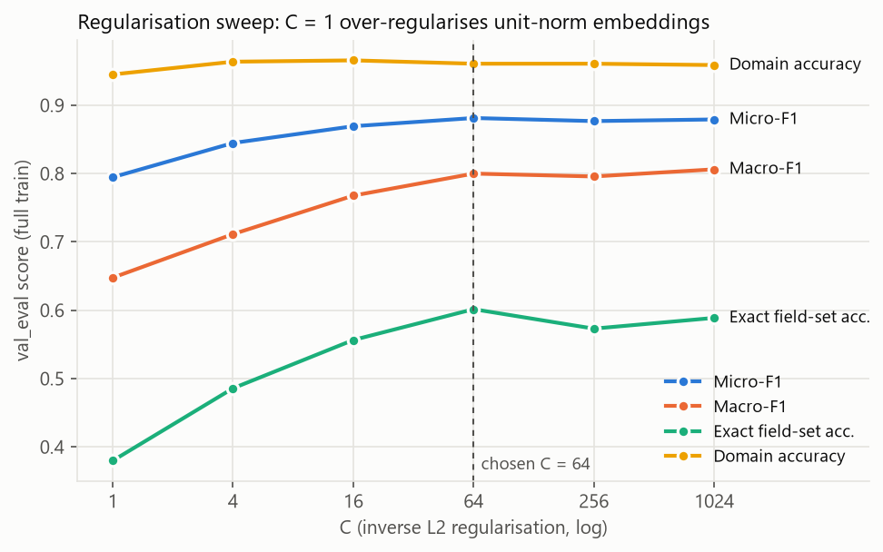
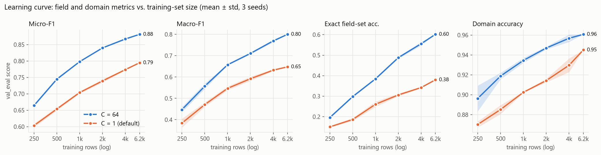
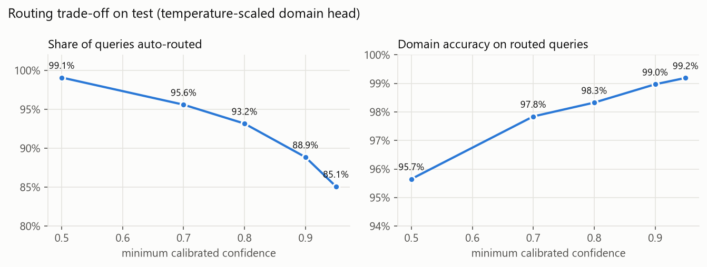
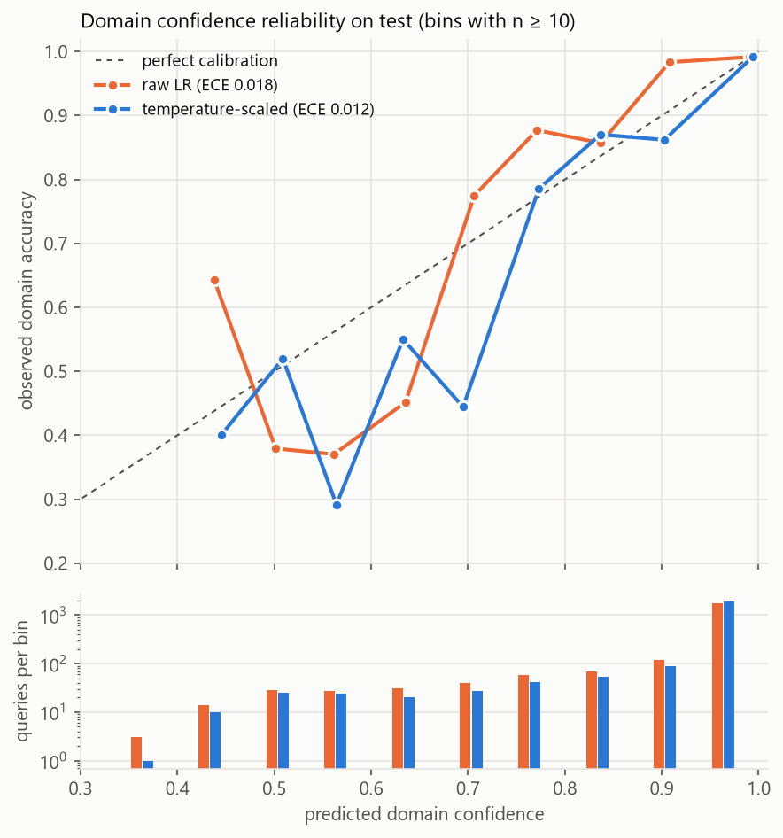
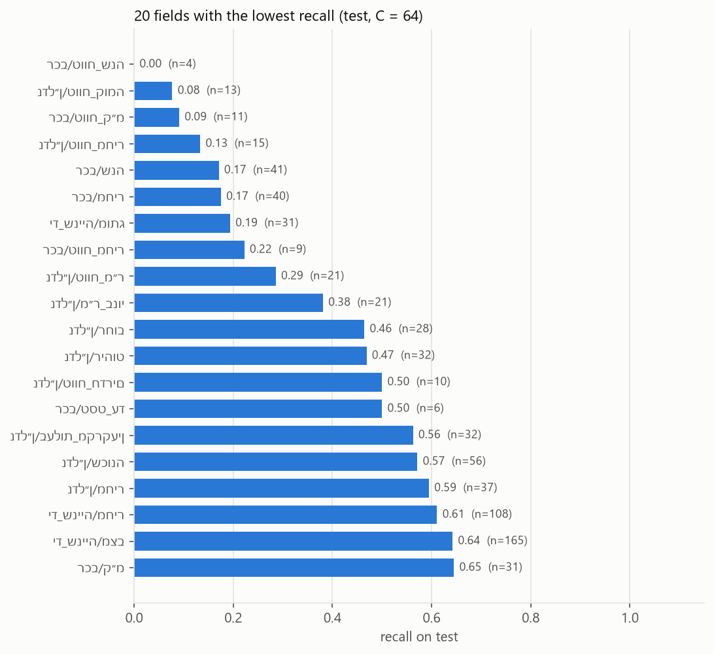

# Experiment 1: frozen E5 embeddings + logistic-regression heads

```
Hebrew query → multilingual-e5-small (frozen, 384-d, "query: " prefix, L2-normalised)
             ├─ domain head: multinomial LogisticRegression → {נדל״ן, רכב, יד_שנייה, none}
             └─ field head:  OneVsRest LogisticRegression over 77 "<domain>/<field>" labels
             → calibration on val_calib → [later: typed value extraction → taxonomy validation → JSON]
```

## Run
```bash
pip install -r training/requirements.txt
cd training/experiment_1
python preprocess.py                       # labels/<split>.json (+ _meta.json), field_vocab.json, val_split.json
python embed.py                            # caches embeddings/<split>.npy; reruns hit the cache
python run_experiment.py --C 64            # learning curve 250→all, 3 seeds per size, eval on val_eval
python run_experiment.py --c-grid 1 4 16 64 256 1024
python run_experiment.py --final-test --C 64   # full train → test + gold subset; saves models/heads.joblib
python plot_results.py                     # PNG charts → artifacts/results/plots/
```

## Data and splits (`../data/split1`)
| split | rows | role |
|---|---|---|
| train | 6171 | fitting (learning-curve subsets are drawn as whole families, keeping the domain mix) |
| val_calib | 1023 | calibration + threshold tuning (half of val) |
| val_eval | 1019 | model selection / learning curve (other half of val) |
| test | 2181 (717 gold) | evaluated once, for the chosen config |

The val split is a 50/50 `StratifiedGroupKFold` (grouped by `family`, stratified by domain). Of 20 seeded
candidates, the most domain-balanced one is kept. `domain=null` rows become `domain_label: "none"` with no fields.

## Calibration
- **Domain**: temperature, sigmoid and isotonic are compared by 5-fold CV log-loss inside val_calib, and the best
  one is refit on all of val_calib. Temperature wins (T≈0.375, i.e. the raw LR is *under*-confident).
- **Fields**: per-field Platt scaling (for fields with ≥5 positives in val_calib), then decision thresholds tuned
  for micro-F1: one global value plus per-field values where val_calib has ≥10 positives.
- Variants reported: `raw` (no calibration, threshold 0.5), `calibrated` (+Platt and tuned thresholds),
  `full` (+ fields masked to the predicted domain), `full_min1` (+ at least one field for a non-`none` domain).

## Results
Default C=1.0 heavily over-regularises unit-norm embeddings. On full train, val_eval, variant `full`:

| C | domain acc | micro-F1 | macro-F1 | exact set |
|---|---|---|---|---|
| 1 | 0.945 | 0.795 | 0.648 | 0.380 |
| 16 | **0.966** | 0.869 | 0.768 | 0.556 |
| 64 | 0.961 | **0.881** | 0.800 | **0.602** |
| 1024 | 0.959 | 0.879 | **0.806** | 0.589 |



Learning curve, C=64, val_eval, variant `full` (mean ± std over 3 seeds):

| n_train | domain acc | micro-F1 | macro-F1 | exact set | domain ECE |
|---|---|---|---|---|---|
| 250 | 0.896 ±0.013 | 0.664 | 0.447 | 0.196 | 0.035 |
| 500 | 0.919 | 0.745 | 0.557 | 0.298 | 0.023 |
| 1000 | 0.935 | 0.798 | 0.657 | 0.385 | 0.019 |
| 2000 | 0.947 | 0.840 | 0.711 | 0.488 | 0.019 |
| 4000 | 0.957 | 0.867 | 0.769 | 0.556 | 0.018 |
| 6171 | 0.961 | 0.881 | 0.800 | 0.602 | 0.015 |



Final, C=64, variant `full`:

| eval set | domain acc | micro-F1 | macro-F1 | exact set | domain ECE |
|---|---|---|---|---|---|
| test (2181) | 0.953 | 0.850 | 0.745 | 0.522 | 0.012 |
| test gold (717) | 0.957 | 0.806 | 0.694 | 0.403 | 0.021 |

Routing on test (calibrated domain confidence): conf ≥0.9 covers 89% of queries at 99.0% domain accuracy, and
conf ≥0.95 covers 85% at 99.2%.





## Observations
- The curve is still rising at 6k rows (+1.4 micro-F1 points and +4.6 exact-set points from 4k to 6k), so more
  data should keep helping.
- Calibration + tuned thresholds + domain masking add about 2 micro-F1 and 6 exact-set points over `raw`.
- Weakest fields are **range / number** fields (`טווח_מחיר`, `טווח_קומה`, `טווח_ק״מ`, `רכב/שנה`, `רכב/מחיר`) and
  off-list `יד_שנייה/מותג`. A sentence embedding cannot reliably tell "price" from "price range", or see a bare
  number. These belong to the span/value extraction stage (or a token-level tagger), not the pooled classifier.
- `none` recall is the weak domain class (0.73 on test). The `unsupported` complexity bucket has only 0.76
  domain accuracy.
- `typo` queries are the hardest language bucket (exact set 0.47 vs 0.56 for `standard`).
- `field_ece` is computed over all rows×77 fields, so it is dominated by easy negatives. Read it as a sanity
  check only.

Artifacts: `artifacts/results/` (committed: learning curves, C sweep, `final_test.json` with per-field recall,
confusion matrix, reliability tables and breakdowns). `embeddings/`, `labels/` and `models/` are regenerable
and git-ignored.
